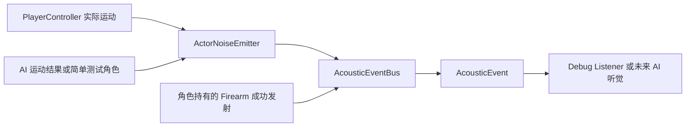

# Phase 8A — Gameplay Acoustic / Noise System 设计草稿 v3

状态：v3 已经用户审阅通过，并于 2026-10-05 实施完成。下文保留实施前设计依据；实际验证结果见 ../plans/2026-10-05-gameplay-acoustic.md。Enemy / Cover 设计继续搁置。

## 1. 本次规则修改与范围

在原 Sneak、Walk、Sprint、Gunshot 基础上新增 ADS、INJURED 两种模式，以及独立的 Landing 脚步事件。

- 无腿伤时，ADS 的声音传播与 Sneak 相同，默认 5m；腿伤声音始终优先使用 INJURED 的 15m，包括 ADS。
- 腿部受伤进入独立 INJURED 移动模式，固定速度 2.5 m/s，替代“基础速度 × 腿部倍率”。
- INJURED 默认声音半径 15m，完整步距离 0.9m，停止补发阈值 0.25m。
- Landing 每次真正从空中落到地面发送一次，传播半径 20m。
- 脚步发声组件同时服务 Player 与 AI；AI 的实际移动、ADS、腿伤、落地和真正射击都能产生同类 Gameplay AcousticEvent。
- 此阶段不实现 AI 行为、Enemy 战斗、掩体、巡逻、真实音频素材、遮挡/衰减、材质、混响、消音器或 Multiplayer。

## 2. 当前项目事实

已检查 PlayerController、Player 场景、Firearm、WeaponData、Test Rifle、BodyInjuryComponent 和相关测试。

当前 normal_speed=5、aim_speed=3；腿部受伤倍率为 0.6，躯干倍率为 0.8。组合伤势测试目前期待 2.4 m/s 普通移动和 1.44 m/s ADS。最新用户要求明确取代这个腿伤移动规则，不能同时保留这两个旧速度期望。

Firearm 的 Hitscan / Projectile 共享成功射击分支，声学事件可接入此处，不需要重写枪械或命中逻辑。当前没有 AI 控制器，AI 适用性用一个不含决策状态的测试角色验证。

Phase 7 的 894 项是已有基线；本轮设计未重新运行，不声称 Phase 8A 测试通过。

## 3. 通用结构

采用 AcousticEvent → AcousticEventBus → Listener；移动源使用通用 ActorNoiseEmitter，替代原计划的 PlayerNoiseEmitter。不建立重复的 Player/AI 脚步实现，也不保留无用途的兼容包装。

ActorNoiseEmitter 负责位移、模式切换、停止结算和落地事件，不读取 Input、不操控角色、不引用 PlayerController 或 AIController。角色控制器完成实际移动后，每次物理更新提交一次 observe_movement(position, velocity, grounded, movement_mode, aiming)。

同一个观察接口用于 PlayerController 和未来 AIController。AI 可以选择 Walk/Sneak/Sprint/ADS，腿伤进入 INJURED，再提交实际运动结果；无需修改 Bus、Listener 或脚步算法。

共享枚举 MovementMode { SNEAK, WALK, SPRINT, ADS, INJURED } 定义在 ActorNoiseEmitter。PlayerController 通过常量引用共享枚举；未来 AI 同样使用，组件不依赖具体角色脚本。

事件 source 显式绑定角色 Node。Player 场景将其绑定 Player；AI 场景绑定所属 AI，而不是发声组件本身。ActorNoiseEmitter 的参数通过 Inspector 配置，两类角色可共享默认值或分别调整。

## 4. 模式与参数

| 模式 | 默认移动速度 | 默认声音半径 | 完整步距离 | 停止补发阈值 |
| --- | ---: | ---: | ---: | ---: |
| SNEAK | 2.5 m/s | 5 m | 0.9 m | 0.25 m |
| WALK | 5.0 m/s | 15 m | 1.2 m | 0.30 m |
| SPRINT | 7.5 m/s | 30 m | 1.4 m | 0.40 m |
| ADS | 3.0 m/s | 同 SNEAK，默认 5 m | 同 SNEAK，默认 0.9 m | 同 SNEAK，默认 0.25 m |
| INJURED | 固定 2.5 m/s | 15 m | 0.9 m | 0.25 m |

移动速度由角色控制器配置，声学参数由 ActorNoiseEmitter 配置。INJURED 速度可在 Inspector 修改，但实际应用是独立值，不再次乘伤势移动倍率。

ADS 的半径直接引用 Sneak 参数；本草稿也让 ADS 的完整步距离与停止阈值引用 Sneak 参数，避免两套默认相同的值逐渐偏离。用户本次只明确要求 ADS 传播同 Sneak，此处步距/阈值沿用是待审阅的设计选择。

LANDING 不是持续 MovementMode，而是独立一次性事件：landing_noise_radius=20.0，可 export；不累计步距、不按当前模式调整半径。

## 5. 移动模式与发声模式的优先级

移动速度模式与 aiming 状态分开，以免“固定腿伤速度”与“瞄准声音同 Sneak”互相覆盖。

### 5.1 移动速度

1. BodyInjuryComponent.legs_injured=true → INJURED，速度直接取 injured_speed=2.5。
2. 没有腿伤且 aiming=true → ADS，基础速度取 aim_speed=3.0；同时按 Ctrl 时保持原 Sneak ADS 慢速行为，取 min(aim_speed, sneak_speed)=2.5。
3. 否则 Ctrl → SNEAK；否则 Shift → SPRINT；否则 WALK。Ctrl 与 Shift 同按时 SNEAK 优先。
4. 非 INJURED 时仍可应用躯干受伤倍率 0.8；INJURED 时不乘腿部或躯干移动倍率，保证腿伤后的最终速度就是单独设置的 2.5。

腿伤后 Shift 不恢复 Sprint；Ctrl 不改变固定伤后速度；ADS 仍允许瞄准、FOV 插值与原射击精度，但不改 INJURED 速度。恢复腿部健康后按当前输入重新选择模式，不永久改写普通速度。

“腿伤”沿用 Phase 7 的 legs_injured 信号语义，即 Legs HP 首次归零后；轻微扣血但尚未进入该伤势状态不会立刻切换 INJURED。

### 5.2 发声模式

发声优先级为 INJURED > ADS > 其他实际移动模式。腿伤时始终使用 INJURED 声学参数；无腿伤且 aiming=true 时使用 ADS 参数；否则使用实际移动模式。这样：

- 腿伤、不 ADS → 2.5 m/s，15m 半径，0.9m 步距，0.25m 停止阈值。
- 腿伤 + ADS → 仍为 2.5 m/s，使用 INJURED 类别与 15m 半径，步距 0.9m，停止阈值 0.25m。
- Shift + ADS → 退出 Sprint；无腿伤时 ADS 3.0 m/s、5m 声音。
- 无腿伤的 Sneak + ADS → 2.5 m/s、5m 声音。
- 任意模式落地 → 独立 20m Landing 事件。

用户已确认：移动与声音都优先 INJURED，腿伤声音始终为 15m，包括 ADS。Player 与 AI 使用同一优先级；瞄准、FOV 和射击精度仍可正常生效。

模式切换结算以有效发声模式的变化为依据。Walk→ADS 先结算 Walk；ADS 中出现腿伤时，先按旧 ADS 参数结算残余并清零，再切换为 INJURED。腿伤期间进入或退出 ADS，有效发声模式仍为 INJURED，不额外结算或重置残余。腿部恢复健康且仍在瞄准时，先结算 INJURED，再切换 ADS。

## 6. Phase 7 伤势规则的迁移

只改腿伤的移动表达，不改身体 HP、Armor、Overall 唯一死亡条件、Head/Arms 后坐力、散布、Reload 或腿伤跳跃倍率 0.5。

BodyInjuryComponent 继续提供 legs_injured。旧 legs_movement_multiplier=0.6 从有效移动计算和 Inspector 中移除，避免留下一个看似能调速却实际无效的参数。get_movement_multiplier() 改为仅返回躯干倍率；控制器遇到 INJURED 时直接使用固定伤后速度，不调用该倍率。

旧测试中至少四条断言需要因规则变更而更新：

- 腿伤移动倍率 0.6 → 腿伤由 INJURED 模式提供固定速度；组件不再返回腿部移动倍率。
- 躯干 + 腿部乘积 0.48 → 倍率组件仅返回躯干 0.8；受伤模式的实际速度另测为 2.5。
- 组合伤势实际普通移动 2.4 → 2.5 m/s。
- 组合伤势实际 ADS 移动 1.44 → 2.5 m/s。

保持原测试覆盖目的并按新契约更新，不通过删除断言或隐藏错误“保住”旧结果。除此之外的 894 项基线行为继续回归；最终报告明确区分因设计变更而调整的旧断言与新增测试。

## 7. AcousticEvent、Bus 与类别

scripts/systems/acoustic_event.gd：class_name AcousticEvent，extends RefCounted，保存 position、radius、category、source、timestamp。timestamp 是本次运行的单调时间秒数。

类别集中定义为 StringName 常量：

- footstep_sneak
- footstep_walk
- footstep_sprint
- footstep_ads
- footstep_injured
- footstep_land
- gunshot

ADS 和 Sneak 类别可区分，但传播参数相同。INJURED 可单独识别，不伪装为 Walk。Landing 与移动脚步分开，监听者不用猜测事件来源。

scripts/systems/acoustic_event_bus.gd：class_name AcousticEventBus，extends Node；提供 sound_emitted(event) 与 emit_sound(position, radius, category, source)。每次创建独立事件，同步发信号，不保存永久历史，不了解任何角色实现。

Autoload 实例命名 GameplayAcoustics，与 class_name AcousticEventBus 区分。正式逻辑不依赖 Debug Listener 或真实 AudioStream。

## 8. 步距、停止与模式切换

ActorNoiseEmitter 保存 previous_position、distance_accumulator、上一有效发声模式、上一 moving / grounded 状态。首次观察只建立基线。

每次观察：

1. 计算真实位置差的 XZ 长度，更新 previous_position；不使用速度 × delta 代替实际位移。
2. 当前在空中：不发移动脚步或停止补发，清零残余和 moving 状态，并记录当前模式。
3. 检测到空中→地面：进入下面的独立 Landing 处理，清零残余并建立新地面基线；此帧不累计普通脚步。
4. 连续在地面且有效发声模式变化：先用旧模式的 stop_flush_min_distance 结算旧残余，达到阈值发一次旧类别事件；无论是否发送，都清零，再切换。
5. 地面且水平速度大于 export 阈值 0.05 m/s：累计实际水平位移；while accumulator >= step_distance，发送当前模式事件并减去一个步距，保留余量。
6. 上一帧 moving、当前停止：达到停止阈值时补发一次；无论是否发送，都清零。持续停止没有新边沿，不重复补发。

停止补发允许当前速度为零，但仍须在地面。模式变化与停止同帧只结算旧模式一次。墙前有输入但没有真实位移不累计；独立 tiny input 不跨停止阶段拼成一步。

阈值最多采用约 0.00001m 浮点容差，保持同轨迹 30/60/120Hz 计数一致；不放宽听觉边界。Teleport/Reset 应调用位置基线重置接口，避免把瞬间位置变化当成跑动或落地，该接口服务角色实际重生/传送而非仅用于测试。

## 9. Landing

以连续观察到的 grounded=false → true 为触发边沿。发送一次 footstep_land，position 为实际落地点，radius=20m，source 为该角色。

- 初次观察不发 Landing；直接出生在地面不会产生假落地。
- 出生在空中且之后真正落地，会正常产生一次事件。
- 起跳与滞空不发送；持续站在地面不重复。
- Landing 同帧不做普通完整步、stop flush 或模式切换补发。
- 清零旧残余；后续地面移动重新累计。
- Sneak、ADS、INJURED 不降低 Landing 的 20m 半径。
- 第一版不按坠落高度、速度、材质调整音量或半径，不引入落地伤害。

静止落地也能发送：Landing 不要求水平速度超过阈值。Player 与 AI 使用同一逻辑。

## 10. Gunshot 与 AI 发声兼容

WeaponData 增加 gunshot_hearing_radius=200.0，Test Rifle 显式保存 200m。

Firearm 真正成功发射后，在 Hitscan / Projectile 公共分支仅发布一次 Gunshot。position 使用 Muzzle.global_position；source 使用实际持枪 CharacterBody3D，而非默认填 Player 节点。

当前 Firearm 的射手引用虽名为 player，但类型是所属 CharacterBody3D；设计要求绑定实际武器持有者，AI 使用现有武器层级/接口时同样发布自身来源的事件。本阶段不建立第二份 AI Firearm、不绕过 RPM、不重写枪械系统。

EMPTY、RELOADING、冷却拒绝、仅扣 Trigger 均不发送。Projectile impact/过期也不额外发送。Mixed Ammo 仍用 fired_round 进行伤害/弹道计算，但声音半径统一来自 WeaponData。

600 RPM 事件数必须与真实发射数一一对应。旧测试允许包含两端点时的 10–11 发；新增精确一秒计数使用 [0,1) 或等价无重复端点采样，期望约 10 次，不按帧发声。

AI 适用性通过简单测试 Actor 验证：输入独立于键盘，提交移动/aiming/grounded 观察，并使用实际 Firearm 进行受控射击。它没有感知、行为状态或导航决策，不属于 Enemy Combat 实现。

## 11. 听觉工具与 Debug Listener

通用 is_event_audible(listener_position, event) 判断 distance <= radius，边界等于半径可听见。

延续上一草稿的待审阅选择：采用三维直线距离；“不考虑 height”解释为不额外施加高度差衰减。若需要忽略 Y，则统一改为 XZ 距离，不在 Player/AI 两侧使用不同规则。

不做 World Raycast、Occlusion、Wall attenuation 或材质查询。相同距离下，Listener 对 Player 与 AI 事件使用完全相同的半径规则。

scripts/tests/debug_acoustic_listener.gd 只作为测试 Node，记录类别、位置、半径、source、timestamp，提供清空记录；不加入正式地图依赖，不每帧打印。

## 12. 拟变更文件

新增：

- scripts/systems/acoustic_event.gd
- scripts/systems/acoustic_event_bus.gd
- scripts/systems/actor_noise_emitter.gd
- scripts/tests/debug_acoustic_listener.gd
- tests/acoustic_event_test.gd
- tests/actor_noise_test.gd
- tests/acoustic_gameplay_test.gd

修改：

- scripts/player/player_controller.gd：共享模式、配置速度、输入/ADS、固定 INJURED 速度、移动观察提交。
- scenes/player/player.tscn：ActorNoiseEmitter，绑定 Player source。
- scripts/combat/body_injury_component.gd：移除腿部移动倍率；保留伤势状态、躯干倍率及其他伤势规则。
- scripts/weapons/weapon_data.gd：枪声半径。
- data/weapons/test_rifle.tres：200m。
- scripts/weapons/firearm.gd：真实发射的公共事件入口、正确的持枪角色 source。
- project.godot：GameplayAcoustics Autoload、sprint=Shift、sneak=Ctrl。
- tests/body_health_test.gd 与 tests/injury_gameplay_test.gd：更新上述因腿伤移动契约改变的断言。

不新增 AIController 或 Enemy 场景，不恢复 Cover 草稿。AmmoData、BallisticProjectile、Armor、BodyHealth、HitMarker 和 addons/godot_ai 不因本设计改写。

## 13. 验收测试

### 声学数据与边界

验证全部七类别、五字段、正确 source、单调 timestamp、事件实例独立，总线每次 emit 恰好一次通知。

半径边界包括 5、15、20、30、200m；测试每个半径的 r-0.1、r、r+0.1，期望 true/true/false。20m 组具体为 19.9/20.0/20.1。无腿伤 ADS 使用 5m 组，INJURED（包括 ADS）使用 15m 组。覆盖非原点、Player/AI 两种 source 与所选垂直距离定义。

### 30/60/120Hz 与防 spam

按相同实际水平轨迹分别采样，并验证类别、计数和余量。无位移、单纯垂直变化、空中水平移动、顶墙不发普通脚步；大位移能产生多个完整步。

默认一秒连续地面移动后停止，不含 Landing，预期：

| 模式 | 距离 | 移动中完整步 | 停止补发 | 合计 |
| --- | ---: | ---: | ---: | ---: |
| SNEAK | 2.5m | 2 | 1 | 3 |
| WALK | 5m | 4 | 0 | 4 |
| SPRINT | 7.5m | 5 | 1 | 6 |
| ADS | 3m | 3 | 1 | 4 |
| INJURED | 2.5m | 2 | 1 | 3 |

三种采样率均应得到同样结果，不能是 30/60/120 个事件。

### Partial step 与切换

Sneak 0.1m stop→0，0.3m→1，0.8m→1，0.95m→1 total；ADS 使用同阈值测试。INJURED 也验证 0.1/0.3/0.8/0.95m，以及事件半径始终为其有效模式参数。

Walk 和 Sprint 验证停止阈值两侧与完整步之后的小余量。连续停止不重复；tiny input 不跨段累计。Walk 0.4m→Sprint 先结算一次 Walk 并清零；Walk→ADS、Walk→INJURED、ADS 中出现腿伤、腿伤恢复后回到 ADS 均测旧模式结算与新参数。腿伤期间切换 ADS 不切换发声模式、不补发或清零残余，后续事件仍为 INJURED / 15m。Player 与测试 AI 均覆盖这些情况。

### Landing

Player 和测试 AI 均测：跳起无声音、空中无普通脚步、落地恰好一次 20m、连续接地不重复、静止落地会响、出生在地面不响、出生空中后真实落地会响、模式不改变半径。带残余距离落地也不得重复发一个普通脚步；下一次地面移动从零累计。覆盖 30/60/120Hz。

### Gunshot 与 AI 兼容

SEMI 一次真射击→一次；按住不重复；AUTO 每发→一次；两种 FireModel 一致；600 RPM 各采样率与实际发射数一致；空膛/换弹/冷却零事件；impact/过期不加 Gunshot；Mixed Ammo 不改 WeaponData 半径。

相同的 ActorNoiseEmitter 分别绑定 Player 与非 Player 测试角色，验证五模式、Landing、source 身份与通用 Listener 行为。实际持枪测试角色的 Gunshot source 必须指向自身。

### 移动与伤势回归

验证所有可配置速度；ADS 取消 Sprint、Sneak ADS、双键优先级；Legs 未归零不触发 INJURED、归零后固定 2.5；腿伤 + 躯干伤仍 2.5；腿伤 ADS 仍 2.5 且使用 INJURED / 15m；恢复后返回正常模式。

腿部跳跃仍 ×0.5；Head/Arms recoil 与 Reload 不变，Overall 才死亡，护甲与 HitMarker/Projectile/Hitscan/弹匣继续回归。

## 14. 验证与下一步

审阅后才实施。实现时先写失败测试，再增加最小逻辑；不为测试增加生产专用分支。保存 Player 场景后从磁盘重载并检查组件绑定，检查 Autoload/class_name 不同名。

完整执行更新契约后的既有测试与新增测试。最终数量以实际 PASS 输出为准，不能继续宣称“894 项旧语义完全不变”；需列出由用户本次设计修改而更新的断言，其余回归保持。

检查 Parser、Runtime、Warnings 与当前 Godot Output，不隐藏警告。保护 addons/godot_ai，不安装插件。此轮只有设计更新，没有测试结果。

已确认腿伤声音始终优先 15m，包括 ADS。本草稿其余待审阅选择：腿伤模式固定速度是否也排除躯干减速；ADS 步距/停止阈值是否完全沿用 Sneak；腿伤触发是否沿用 Phase 7 HP 归零状态；听觉采用三维或水平距离。推荐值均已写明，可直接对这些点提出修改。
